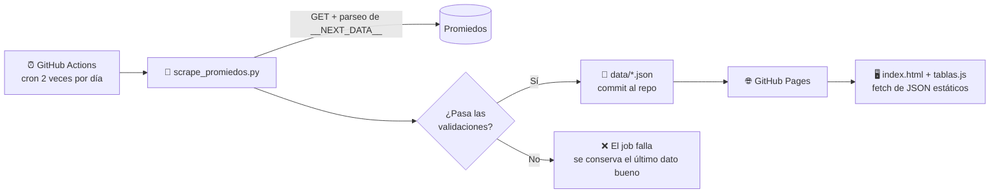

<div align="center">

# ⚽ Fútbol Argentino — Tabla de Posiciones

**Tablas de posiciones, promedios y fixture de la Liga Profesional Argentina, actualizados automáticamente y servidos como sitio 100 % estático.**


[**Ver demo en vivo**](https://gastonpaez.github.io/web_score_scraping/) · [Reportar un problema](https://github.com/GastonPaez/web_score_scraping/issues)

</div>

---

## 📌 Descripción

Este proyecto obtiene los datos de la **Liga Profesional Argentina** desde [Promiedos](https://www.promiedos.com.ar), los normaliza y valida con un scraper en Python, y los publica como archivos JSON que consume un front-end liviano y responsive.

La arquitectura está pensada para ser **gratuita, robusta y sin servidores**: un workflow de GitHub Actions ejecuta el scraper dos veces por día, commitea los JSON actualizados en el repositorio y GitHub Pages sirve el sitio. El navegador solo lee archivos estáticos: no hay API keys, ni CORS, ni dependencias de servicios externos en tiempo de ejecución.

### Qué muestra el sitio

| Vista | Contenido |
|---|---|
| **Posiciones** | Tabla de la fase en curso (una o varias zonas), con PJ, G, E, P, GF, GC, diferencia y puntos, y las zonas de clasificación/descenso resaltadas con su leyenda. |
| **Promedios** | Tabla de promedios con columnas dinámicas por temporada. |
| **Fixture** | La fecha actual y la siguiente, con horario local, estado del partido (programado, en juego, finalizado) y resultado. |

---

## 🏗️ Arquitectura



---

## 🧠 Habilidades y decisiones técnicas destacadas

### Web scraping resiliente
- **Extracción desde `__NEXT_DATA__` en lugar de selectores CSS.** Promiedos es una aplicación Next.js que embebe todos los datos de la página en un bloque JSON. El scraper lo lee directamente con una sola petición HTTP, sin parsear HTML ni ejecutar JavaScript, lo que lo hace mucho más estable frente a cambios de diseño visual.
- **Sin supuestos rígidos sobre el torneo.** No se hardcodea la cantidad de zonas ni sus nombres, y las zonas de clasificación se toman de los propios datos (no se infieren por posición). Si el formato pasa de dos grupos a una tabla única, el código sigue funcionando.
- **Consumo mínimo y respetuoso de la fuente.** Dos requests por ejecución, `User-Agent` identificable con enlace al repositorio y timeouts explícitos.

### Calidad y validación de datos
- **Validaciones de sanidad antes de publicar:** cantidad mínima de equipos por tabla, equipos sin nombre, coherencia aritmética (`G + E + P = PJ`), puntos imposibles (`PTS > PJ × 3`) y orden de posiciones.
- **Fallar de forma segura:** si los datos no son confiables, el script sale con código distinto de cero, el job de CI falla y **no se commitea un JSON roto**; el sitio sigue mostrando el último dato válido.
- **Degradación elegante:** si falla la descarga de la fecha siguiente del fixture, se publica igual la fecha en curso.
- Modo `--dry-run` para validar sin escribir archivos.

### Automatización y DevOps
- **Pipeline ETL serverless** (extracción → normalización → validación → publicación) ejecutado con GitHub Actions y desplegado en GitHub Pages, con costo de infraestructura cero.
- Migración de una arquitectura basada en **Scrapy + Scrapinghub/Zyte** (con una API key consumida desde el navegador) a un pipeline autocontenido en el propio repositorio.

### Front-end
- **JavaScript vanilla** sin frameworks ni build step, con Tailwind CSS para el diseño.
- **Diseño mobile-first:** las columnas tienen prioridades y se ocultan progresivamente según el ancho de pantalla, evitando el scroll horizontal en celulares.
- **Seguridad:** todo el contenido externo se inserta con `textContent`, nunca con `innerHTML`, para prevenir inyección de HTML.
- **Accesibilidad:** `aria-live`, `aria-busy`, `aria-current`, elementos `<time>` semánticos y respeto de `prefers-reduced-motion`.
- **UX honesta con datos no en vivo:** un partido "en juego" en una captura antigua se muestra como último dato conocido, sin simular un vivo que no existe.
- **Manejo correcto de zonas horarias:** los horarios se emiten en ISO 8601 con offset `-03:00` y se formatean en el navegador con `Intl.DateTimeFormat` (`es-AR`).
- Estados de carga con esqueletos y manejo explícito de errores.

---

## 🛠️ Stack tecnológico

| Capa | Tecnologías |
|---|---|
| Scraping y procesamiento | Python 3.11, httpx, `re`, `json`, `datetime` |
| Automatización | GitHub Actions (ejecución programada) |
| Hosting | GitHub Pages |
| Front-end | HTML5, JavaScript (ES2020+), Tailwind CSS, Google Fonts (Barlow Condensed, Inter) |
| Formato de datos | JSON |

---

## 📂 Estructura del proyecto

```
web_score_scraping/
├── index.html                  # Página principal (navegación entre vistas)
├── css/
│   └── main.css                # Estilos complementarios a Tailwind
├── js/
│   ├── tablas.js               # Render de posiciones, promedios y fixture
│   └── scrapy_table.js         # Versión legacy (Scrapinghub), sin uso actual
├── data/                       # Generado automáticamente por el scraper
│   ├── posiciones.json
│   ├── promedios.json
│   └── fixture.json
├── scraper/
│   ├── scrape_promiedos.py     # Extracción, normalización y validación
│   └── requirements.txt
└── src/
    └── wallp1.jpg              # Imagen de fondo del encabezado
```

---

## 📊 Formato de los datos

Todos los archivos incluyen la fecha de actualización (UTC) y la fuente. Ejemplo resumido de `data/posiciones.json`:

```json
{
  "actualizado": "2026-09-18T21:51:13+00:00",
  "fuente": "https://www.promiedos.com.ar/league/liga-profesional/hc",
  "torneo": "Liga Profesional Argentina",
  "fase": "Clausura",
  "grupos": [
    {
      "nombre": "Grupo A",
      "zonas": ["Octavos de Final"],
      "filas": [
        {
          "pos": 1, "equipo": "Defensa y Justicia",
          "pts": 20, "pj": 10, "pg": 6, "pe": 2, "pp": 2,
          "gf": 12, "gc": 9, "dif": 3,
          "zona": "Octavos de Final"
        }
      ]
    }
  ]
}
```

En `data/fixture.json`, cada partido incluye `inicio` en ISO 8601 con offset de Argentina, `estado` (`programado`, `en_juego` o `finalizado`), el `minuto` cuando corresponde y los datos de local y visitante (nombre, nombre corto, goles y color).

---

## 🕰️ Evolución del proyecto

| Versión | Año | Enfoque |
|---|---|---|
| **v1** | 2022 | Spider de Scrapy desplegado en Scrapinghub (Zyte); el navegador consultaba la API de Scrapinghub para obtener los datos. |
| **v2** | 2026 | Scraper propio en Python con httpx sobre `__NEXT_DATA__`, validación de datos, ejecución en GitHub Actions, JSON estáticos versionados en el repo y front-end rediseñado con vistas de promedios y fixture. |

---

## 👤 Autor

**Gastón Páez**

[](https://github.com/GastonPaez)
